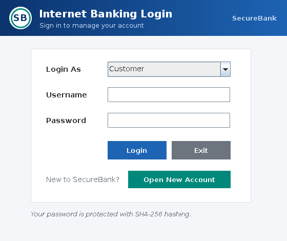
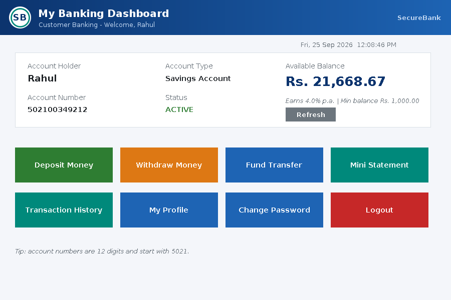
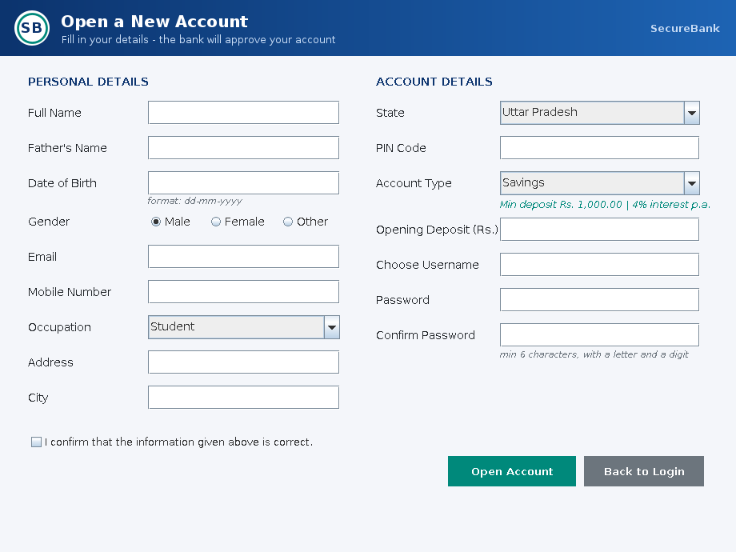
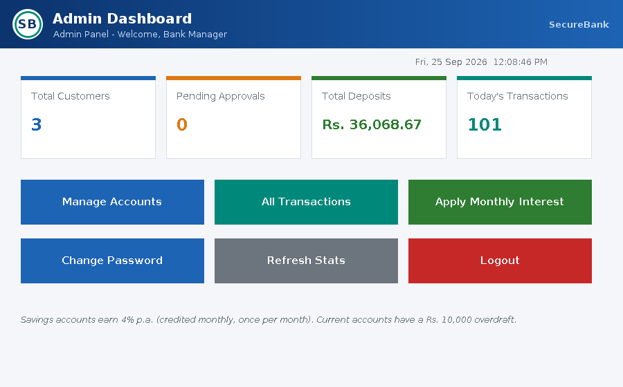
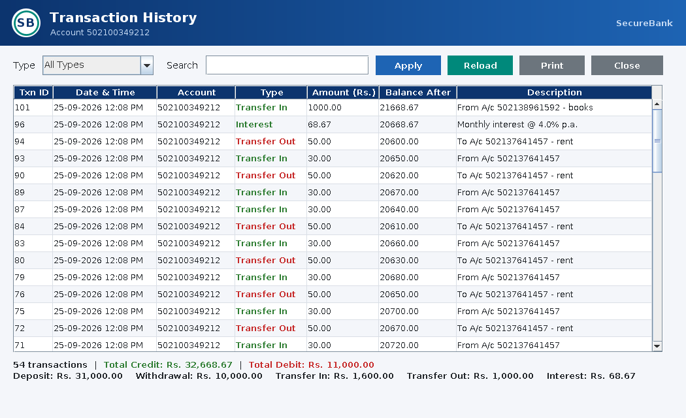
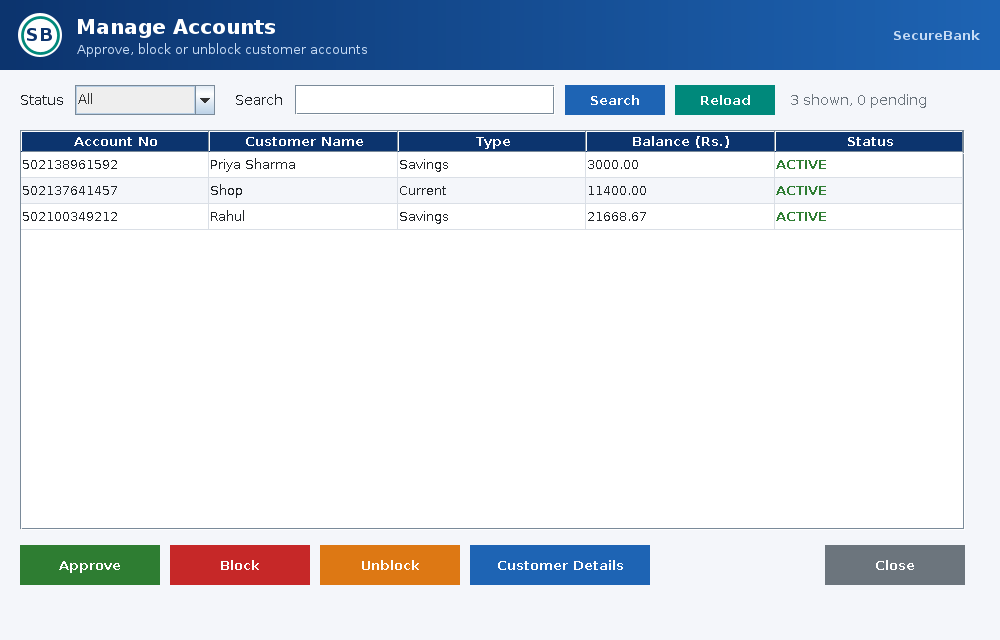

# 🏦 Online Banking System (SecureBank)

A desktop **Online Banking System** built with **Java Swing** and **MySQL (JDBC)**.
Customers open accounts online, deposit, withdraw, transfer money and view statements.
The bank admin approves or blocks accounts, monitors every transaction and credits monthly interest.

The code is organised in layers (UI → Service → DAO → Database) and demonstrates OOP,
Collections & Generics, Multithreading & Synchronization, and JDBC with transactions.

---

## 📋 Table of Contents
- [Features](#-features)
- [Tech Stack](#-tech-stack)
- [Architecture](#-architecture)
- [Project Structure](#-project-structure)
- [Java Concepts Implemented (Rubric Mapping)](#-java-concepts-implemented-rubric-mapping)
- [Requirements](#-requirements)
- [Setup Guide](#-setup-guide)
- [How to Run](#-how-to-run)
- [Default Login](#-default-login)
- [Usage Flow](#-usage-flow)
- [Account Rules](#-account-rules)
- [Database Schema](#-database-schema)
- [Troubleshooting](#-troubleshooting)
- [Known Limitations](#-known-limitations)

---

## ✨ Features

### Customer
- **Open a new account online** (Savings or Current) with full KYC-style form and validation
- Login with a hashed password (SHA-256 + salt)
- Dashboard with live balance, account status and a live clock
- **Deposit**, **Withdraw** (with quick-amount buttons)
- **Fund Transfer** to any account, with beneficiary name verification
- **Mini Statement** (last 10 transactions, printable)
- **Transaction History** with type filter, search, colour-coded credits/debits and totals
- View profile and update contact details
- Change password

### Admin
- Dashboard with live statistics (customers, pending approvals, total deposits, today's transactions)
- **Manage Accounts**: approve new accounts, block / unblock, view full customer details, filter and search
- **All Transactions** across the bank with filter and search
- **Apply Monthly Interest** to all active savings accounts (runs in parallel, once per month)
- Change password

### Safety
- Every money movement is an atomic database transaction (commit / rollback)
- Row locking (`SELECT … FOR UPDATE`) + Java per-account locks prevent double spending
- Deadlock-free transfers (locks always taken in the same order)
- All SQL uses `PreparedStatement` → protected against SQL injection
- Clear error pop-ups for every problem

---

## 📸 Screenshots

| Login | Customer Dashboard |
|---|---|
|  |  |

| Open Account | Admin Dashboard |
|---|---|
|  |  |

| Transaction History | Manage Accounts |
|---|---|
|  |  |

---

## 🛠 Tech Stack

| Layer | Technology |
|---|---|
| Language | Java 17 |
| GUI | Java Swing / AWT (custom-painted header, logo and splash with Java2D) |
| Database | MySQL 8.0 |
| Connectivity | JDBC + MySQL Connector/J |
| IDE / Build | Apache NetBeans + Apache Ant |

---

## 🏗 Architecture

```
┌──────────────────────────────────────────────┐
│ UI layer  (ui package, Swing)                │  LoginFrame, CustomerDashboard, TransferFrame ...
└──────────────────────┬───────────────────────┘
                       │
┌──────────────────────▼───────────────────────┐
│ Service layer  (service package)             │  BankingService, RegistrationService
│ business rules, locks, DB transactions       │  AccountLockManager, AccountNumberGenerator
└──────────────────────┬───────────────────────┘
                       │
┌──────────────────────▼───────────────────────┐
│ DAO layer  (dao package, GenericDAO<T,K>)    │  UserDAO, CustomerDAO, AccountDAO,
│ every SQL statement lives here               │  TransactionDAO, ReportDAO
└──────────────────────┬───────────────────────┘
                       │ JDBC
┌──────────────────────▼───────────────────────┐
│ DBConnection (Singleton) → MySQL online_banking │
└──────────────────────────────────────────────┘
```

---

## 📁 Project Structure

```
Online-Banking-System/
├── online_banking_schema.sql          # creates database, tables, admin and DB user
├── README.md
├── build.xml, manifest.mf, nbproject/ # NetBeans / Ant project files
└── src/
    ├── db.properties                  # database URL, user, password
    └── online/banking/system/
        ├── Main.java                  # entry point
        ├── model/        Person (abstract), Admin, Customer, Transaction, AccountSummary,
        │                 DashboardStats, enums: Role, AccountType, AccountStatus, TransactionType
        ├── account/      Account (abstract), SavingsAccount, CurrentAccount,
        │                 InterestBearing (interface), AccountFactory
        ├── exception/    BankException + 6 custom exceptions
        ├── db/           DBConnection (Singleton, synchronized)
        ├── dao/          GenericDAO<T,K> (interface), UserDAO, CustomerDAO, AccountDAO,
        │                 TransactionDAO, ReportDAO
        ├── service/      BankingService, RegistrationService, AccountLockManager,
        │                 AccountNumberGenerator, TransactionWork<T> (generic functional interface)
        ├── util/         BackgroundTask (SwingWorker), TableModelBuilder, PasswordUtil,
        │                 Validator, MoneyUtil, MessageUtil
        └── ui/           BaseFrame (abstract), HeaderPanel, Logo, UITheme, BankCellRenderer,
                          ClockLabel, SplashWindow, LoginFrame, RegisterFrame,
                          CustomerDashboard, AmountTransactionFrame (abstract), DepositFrame,
                          WithdrawFrame, TransferFrame, MiniStatementFrame,
                          TransactionHistoryFrame, AllTransactionsFrame, ProfileFrame,
                          ChangePasswordFrame, AdminDashboard, ManageAccountsFrame
```

---

## 🎯 Java Concepts Implemented (Rubric Mapping)

### 1. OOP — Polymorphism, Inheritance, Exception Handling, Interfaces (10)

| Concept | Where | What it shows |
|---|---|---|
| **Inheritance** | `Person` → `Admin`, `Customer` | shared id / username / name |
| | `Account` → `SavingsAccount`, `CurrentAccount` | shared deposit / withdraw logic |
| | `BaseFrame` → every screen | shared window setup and helper methods |
| | `AmountTransactionFrame` → `DepositFrame`, `WithdrawFrame` | template-method pattern |
| | `TransactionHistoryFrame` → `AllTransactionsFrame` | reuse by overriding only `fetch()` |
| | `BankException` → 6 child exceptions | exception hierarchy |
| **Abstraction** | `Person`, `Account`, `BaseFrame`, `AmountTransactionFrame` are `abstract` | abstract methods such as `getMinimumBalance()`, `perform()` |
| **Runtime polymorphism** | `account.withdraw()` | Savings keeps ₹1,000 minimum; Current allows ₹10,000 overdraft — decided at runtime |
| | `UserDAO.authenticate()` returns `Person` | Admin or Customer dashboard opens; `getWelcomeMessage()` differs |
| | `ChangePasswordFrame(Person)` | one screen works for both roles |
| | `BankCellRenderer`, `HeaderPanel.paintComponent()` | overriding Swing methods |
| **Interfaces** | `InterestBearing` (only Savings implements it) | `instanceof InterestBearing` decides who earns interest |
| | `GenericDAO<T,K>` with a **default method** | `TransactionDAO` inherits `update()` that forbids editing |
| | `TransactionWork<T>` (`@FunctionalInterface`) | lambdas passed to `inTransaction()` |
| | `ActionListener`, `Runnable`, `FocusListener` | Swing / thread interfaces |
| **Exception handling** | `exception/` | `InsufficientFundsException` (stores requested/available), `AccountInactiveException`, `AccountNotFoundException`, `AuthenticationException`, `InvalidInputException`, `DatabaseException` |
| | DAOs / services | try-with-resources, try-catch-finally, rollback in `catch`, multi-level catch, re-throwing, `throws` |
| **Encapsulation** | all models | private fields, getters/setters, immutable `Transaction` |
| **Enums** | `Role`, `AccountType`, `AccountStatus`, `TransactionType` | enums with fields, constructors and methods |

### 2. Collections & Generics (6)

| Concept | Where |
|---|---|
| `List` / `ArrayList` | every `findAll()` / `findByAccount()` |
| `Set` / `HashSet` | `AccountNumberGenerator` uniqueness check |
| `Map` / `TreeMap` | interest results sorted by account number |
| `EnumMap<TransactionType, BigDecimal>` | per-type totals in Transaction History |
| `ConcurrentHashMap` | `AccountLockManager`, parallel interest results |
| `Optional<T>` | `findById()`, `findByCustomerId()`, `findHolderName()` |
| Streams | filtering in `TransactionHistoryFrame`, `ManageAccountsFrame` |
| Immutable `List.of(...)` | States and occupations in `RegisterFrame` |
| **Generic interface** | `GenericDAO<T, K>` → `CustomerDAO<Customer,Integer>`, `AccountDAO<Account,String>`, `TransactionDAO<Transaction,Long>` |
| **Generic functional interface** | `TransactionWork<T>` |
| **Generic methods** | `BankingService.<T>inTransaction()`, `TableModelBuilder.<T>build()`, `BackgroundTask.<T>run()` |
| Generic Swing | `JComboBox<Role>`, `JComboBox<AccountType>`, `SwingWorker<T,Void>` |

### 3. Multithreading & Synchronization (4)

| Concept | Where |
|---|---|
| `Thread` + `Runnable` | `SplashWindow` (progress bar), `ClockLabel` (daemon thread) |
| `volatile` flag | `ClockLabel.running` — stops the clock thread safely |
| `SwingWorker` background threads | `BackgroundTask` — every DB call from the UI runs off the UI thread |
| `SwingUtilities.invokeLater` | UI updates from worker threads |
| `ExecutorService` thread pool + `Future` | `BankingService.applyMonthlyInterest()` processes accounts in parallel |
| `synchronized` method | `DBConnection.getInstance()` |
| `static synchronized` method | `AccountNumberGenerator.generate()` |
| `synchronized` block on per-account lock | deposit / withdraw / interest in `BankingService` |
| **Nested locks with fixed ordering** | `transfer()` — prevents deadlock |
| DB row locks | `SELECT … FOR UPDATE` in `AccountDAO.findByIdForUpdate()` |

Tested: 20 threads withdrawing ₹1,000 each from ₹11,000 → exactly 10 succeed; 40 simultaneous opposite transfers → no deadlock, total money unchanged.

### 4. Classes for Database Operations (7)
- `db/DBConnection` — Singleton connection factory reading `db.properties`
- `dao/GenericDAO<T,K>` — common contract (`add`, `findById`, `findAll`, `update`)
- `UserDAO`, `CustomerDAO`, `AccountDAO`, `TransactionDAO`, `ReportDAO` — one class per table/report
- `service/RegistrationService`, `service/BankingService` — multi-table business operations
- Model classes map rows to objects; `AccountFactory` maps rows to the correct Account subclass

### 5 & 6. JDBC — Connectivity and Implementation (3 + 3)
- `DriverManager.getConnection()` with settings from `db.properties`
- `PreparedStatement` everywhere (SQL-injection safe), `executeQuery` / `executeUpdate`, `ResultSet`
- `Statement.RETURN_GENERATED_KEYS` to read the new `user_id`
- **Transactions**: `setAutoCommit(false)`, `commit()`, `rollback()` — account opening writes 4 tables atomically
- `SELECT … FOR UPDATE` row locking, `JOIN`, aggregate `COUNT/SUM`, `DECIMAL` money with `BigDecimal`
- try-with-resources closes every `Connection`, `PreparedStatement` and `ResultSet`

---

## 💻 Requirements

| Software | Version |
|---|---|
| JDK | 17+ |
| Apache NetBeans | latest |
| MySQL Server + Workbench | 8.0 |
| MySQL Connector/J | 8.0+ (Platform Independent JAR) |

---

## ⚙️ Setup Guide

### Step 1 — Create the database
1. Open **MySQL Workbench** → connect to **Local instance MySQL80** (as root).
2. **File → Open SQL Script** → select `online_banking_schema.sql`.
3. Click **⚡ Execute**.
4. Refresh **Schemas**: database `online_banking` with 4 tables — `users`, `customers`, `accounts`, `transactions`.

The script also creates the default admin and the MySQL user `bankuser` / `bank123` that the app uses.

### Step 2 — Check `src/db.properties`
```properties
db.url=jdbc:mysql://localhost:3306/online_banking?useSSL=false&allowPublicKeyRetrieval=true
db.user=bankuser
db.password=bank123
```
Only change this if you want to use a different MySQL account.

### Step 3 — Open in NetBeans
1. Extract the project, e.g. to `E:\Projects\Online-Banking-System`.
2. **File → Open Project** → select the `Online-Banking-System` folder.
3. The connector is expected at `D:\libs\mysql-connector-j-26.7.0.jar`.
   If yours is elsewhere: right-click project → **Properties → Libraries** → remove the broken entry → **+ → Add JAR/Folder**.
4. Main class is already set to `online.banking.system.Main`.

---

## ▶️ How to Run
1. Make sure the **MySQL80** service is running (Windows → Services).
2. Right-click the project → **Clean and Build** → wait for `BUILD SUCCESSFUL`.
3. Press **F6** or click **▶ Run**.
4. Splash screen → Login window.

---

## 🔑 Default Login

| Role | Username | Password |
|---|---|---|
| Admin | `admin` | `admin123` |

Customers create their own login from **Open New Account** on the login screen.

---

## 🔄 Usage Flow
1. Login screen → **Open New Account** → fill the form (age 18+, valid email, 10-digit mobile, 6-digit PIN) → note the account number.
2. Login as **Admin** → **Manage Accounts** → select the new account → **Approve**.
3. Logout → login as the **Customer** (Login As: Customer).
4. **Deposit**, **Withdraw**, **Fund Transfer** (enter another account number → **Verify** → amount → **Transfer Now**).
5. **Mini Statement** / **Transaction History** to see the records.
6. As Admin, **Apply Monthly Interest** credits 4% p.a. (monthly) to active savings accounts — only once per month.

---

## 📐 Account Rules

| | Savings | Current |
|---|---|---|
| Minimum opening deposit | ₹1,000 | ₹5,000 |
| Minimum balance | ₹1,000 | none |
| Overdraft | none | up to ₹10,000 (balance may go to −₹10,000) |
| Interest | 4% p.a., credited monthly | none |
| Max per transaction | ₹10,00,000 | ₹10,00,000 |

---

## 🗄 Database Schema

| Table | Key columns |
|---|---|
| `users` | user_id (PK, auto), username (unique), password_hash, salt, role, full_name |
| `customers` | customer_id (PK, FK → users), father_name, dob, gender, email, phone, address, city, state, pincode, occupation |
| `accounts` | account_no (PK), customer_id (FK, unique), account_type, balance DECIMAL(15,2), status |
| `transactions` | txn_id (PK, auto), account_no (FK), txn_type, amount, balance_after, description, txn_time |

---

## 🩺 Troubleshooting

| Pop-up message | Fix |
|---|---|
| *Could not connect … Access denied* | Run the full schema script (it creates `bankuser`), or fix `db.properties`, then **Clean and Build** |
| *Could not connect … Communications link failure* | Start the **MySQL80** service |
| *No suitable driver* | Add the Connector/J JAR in **Properties → Libraries** |
| *Unknown database 'online_banking'* | Run `online_banking_schema.sql` |
| *Account … is PENDING* | Admin must approve the account first |
| *Insufficient funds …* | Expected — the message shows how much you can withdraw |

---

## ⚠️ Known Limitations
- Single-machine desktop app; to share across computers, host MySQL online and change `db.url`.
- One account per customer.
- Deposits and withdrawals are simulated cash operations (no payment gateway).

---

## 📄 License
For educational and academic use.
